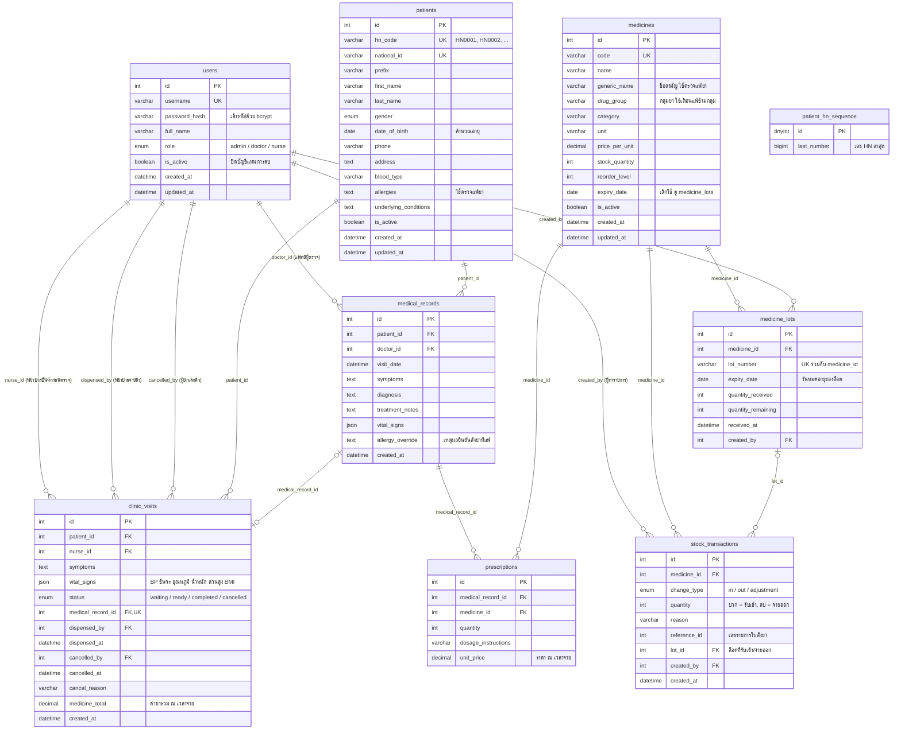

# แผนภาพความสัมพันธ์ของข้อมูล (ER Diagram) — Clinic Flow

ฐานข้อมูล MySQL ชื่อ `clinic_flow` มี 9 ตาราง และความสัมพันธ์ (foreign key) 14 เส้น
โครงสร้างตรงกับ `schema.sql` (ฐานข้อมูลใหม่) และ `npm run migrate` (อัปเกรดฐานข้อมูลเดิม)

## แผนภาพ

แผนภาพนี้แสดงผลอัตโนมัติบน GitHub และใน VS Code (ติดตั้งส่วนขยาย Markdown Preview Mermaid Support แล้วกด Ctrl+Shift+V)
ถ้าต้องการภาพสำหรับรายงาน ให้ export จาก MySQL Workbench (Database → Reverse Engineer)

## ความสัมพันธ์ (14 เส้น)

| ตาราง (ฝั่ง "หลาย") | คอลัมน์ | อ้างอิงตาราง (ฝั่ง "หนึ่ง") | ความหมาย |
|---|---|---|---|
| clinic_visits | patient_id | patients | ผู้ป่วย 1 คน มาเข้าคิวได้หลายครั้ง |
| clinic_visits | nurse_id | users | พยาบาลที่บันทึกข้อมูลก่อนตรวจ |
| clinic_visits | medical_record_id | medical_records | ผลการตรวจของคิวนี้ (1 ต่อ 1, เป็น UNIQUE) |
| clinic_visits | dispensed_by | users | พยาบาลที่ยืนยันจ่ายยา |
| clinic_visits | cancelled_by | users | ผู้ยกเลิกคิว |
| medical_records | patient_id | patients | ผู้ป่วย 1 คน มีประวัติการรักษาได้หลายครั้ง |
| medical_records | doctor_id | users | แพทย์ผู้ตรวจ |
| prescriptions | medical_record_id | medical_records | การรักษา 1 ครั้ง สั่งยาได้หลายรายการ |
| prescriptions | medicine_id | medicines | ยาที่สั่ง |
| stock_transactions | medicine_id | medicines | ประวัติการเคลื่อนไหวสต๊อกของยาแต่ละตัว |
| stock_transactions | created_by | users | ผู้ทำรายการรับเข้า / จ่ายออก |
| stock_transactions | lot_id | medicine_lots | ล็อตที่รับเข้าหรือถูกตัดจ่าย (ยา 1 รายการในใบสั่งอาจตัดจากหลายล็อต) |
| medicine_lots | medicine_id | medicines | ยา 1 ตัว มีได้หลายล็อต แต่ละล็อตมีวันหมดอายุของตัวเอง |
| medicine_lots | created_by | users | ผู้รับยาล็อตนั้นเข้าครั้งแรก |

`patient_hn_sequence` เป็นตารางเดี่ยว ไม่มีความสัมพันธ์กับตารางอื่น ใช้เก็บเลข HN ล่าสุดเพื่อสร้างเลขใหม่ไม่ให้ซ้ำ

## หน้าที่ของแต่ละตาราง

| ตาราง | เก็บข้อมูล |
|---|---|
| users | บัญชีผู้ใช้งาน บทบาท และสถานะเปิด/ปิดบัญชี |
| patients | ข้อมูลส่วนตัวและข้อมูลทางการแพทย์ของผู้ป่วย |
| patient_hn_sequence | ลำดับเลข HN ล่าสุด (มี 1 แถว) |
| clinic_visits | คิวการมารับบริการแต่ละครั้ง ตั้งแต่บันทึกก่อนตรวจจนจ่ายยาหรือยกเลิก |
| medical_records | ประวัติการรักษา: อาการ การวินิจฉัย คำสั่งแพทย์ |
| prescriptions | รายการยาที่สั่งในการรักษาแต่ละครั้ง |
| medicines | ข้อมูลยา ราคา และจำนวนคงเหลือรวม (= ผลรวมคงเหลือของทุกล็อต) |
| medicine_lots | ล็อตยาที่รับเข้า: เลขล็อต วันหมดอายุ จำนวนรับเข้าและคงเหลือ |
| stock_transactions | ประวัติการรับยาเข้าและจ่ายยาออกทุกครั้ง |

## หลักการออกแบบที่ควรกล่าวถึงในรายงาน

- **ไม่ลบข้อมูลสำคัญ:** ผู้ป่วย ผู้ใช้ และยาใช้คอลัมน์ `is_active` แทนการลบ เพื่อคงความสัมพันธ์กับประวัติการรักษาและประวัติสต๊อก
- **เก็บค่า ณ เวลาที่เกิดเหตุการณ์:** `prescriptions.unit_price` และ `clinic_visits.medicine_total` เก็บราคาตอนจ่ายยา แม้ภายหลังเปลี่ยนราคา ประวัติเดิมก็ไม่เปลี่ยน ส่วนสัญญาณชีพเก็บใน `vital_signs` ของการมาแต่ละครั้ง
- **ตรวจสอบย้อนหลังได้:** ทุกขั้นตอนบันทึกผู้ทำรายการ (nurse_id, doctor_id, dispensed_by, cancelled_by, created_by)
- **สต๊อกสอดคล้องกับประวัติ:** การจ่ายยาทุกครั้งสร้างแถวใน `stock_transactions` ภายใน transaction เดียวกับการลดจำนวนใน `medicine_lots` และ `medicines`
- **หมดอายุก่อน จ่ายก่อน (FEFO):** ตอนจ่ายยา ระบบตัดจากล็อตที่หมดอายุเร็วที่สุดก่อน และไม่จ่ายจากล็อตที่หมดอายุแล้ว ทำให้ตามรอยได้ว่าผู้ป่วยได้ยาล็อตไหน (กรณีเรียกคืนยา)

## หมายเหตุ

- **ยอดยกมา:** `npm run migrate` ย้ายสต๊อกเดิมของยาแต่ละตัวเป็นล็อตชื่อ "ยอดยกมา" ใช้วันหมดอายุเดิมของยา (ถ้าไม่มีจะเป็นค่าว่าง และถูกจ่ายก่อนล็อตอื่น)
- **คอลัมน์ที่เลิกใช้:** `medicines.expiry_date` ไม่ถูกใช้แล้ว เพราะวันหมดอายุแยกตามล็อต ฐานข้อมูลที่อัปเกรดมาจากเวอร์ชันแรกอาจมี `patients.weight_kg` และ `patients.height_cm` คอลัมน์เหล่านี้คงไว้เพื่อไม่ให้ข้อมูลเดิมหาย ระบบปัจจุบันไม่ได้ใช้ และไม่มีใน `schema.sql` แล้ว
- **บทบาทที่ยังไม่ได้ใช้:** `users.role` รองรับค่า `pharmacist` และ `staff` เผื่อขยายระบบในอนาคต ปัจจุบันระบบใช้เพียง `admin` (เจ้าของคลินิก), `doctor` และ `nurse`
- **change_type:** `in` = รับยาเข้า, `out` = จ่ายยาตามใบสั่ง, `adjustment` = เจ้าของคลินิกตัดยาหมดอายุออก (ทำลาย/คืนผู้จำหน่าย) บันทึกจำนวนติดลบพร้อมเหตุผล
